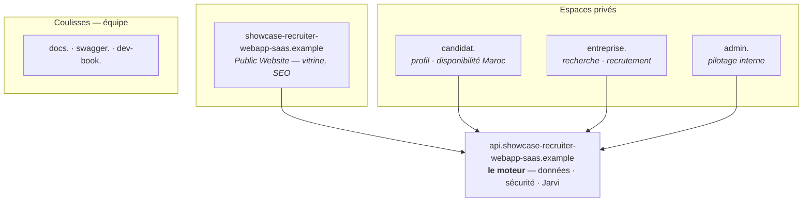

# showcase-recruiter-webapp-saas — Architecture

> Document de synthèse : couches, frontière Jarvi, modèle de données, auth et infra.
>
> Sources : [INITIAL_BRIEF](../../../../requirements/brief/initial_brief.md), [NOTES_EN_VRAC](../../../../dev-book/cadrage/draft/notes_en_vrac.md),
> [PARCOURS_UTILISATEUR_CANDIDAT](../../../../dev-book/cadrage/candidat/ui/parcours_utilisateur_candidat.md),
> [ROADMAP](../../../../dev-book/roadmap.md).

## 1. Vision en une phrase

La seule plateforme dédiée aux profils basés en **Europe** cherchant un emploi au **Maroc**,
donnant aux entreprises marocaines un accès direct à la diaspora, avec une donnée
différenciante : **« quand le candidat sera physiquement présent au Maroc »**.

## Invariants non négociables (garde-fous) {#invariants}

> Règles **structurantes** que tout agent / contribution doit respecter et **ne jamais enfreindre**.
> Foyer canonique de ces invariants (référencés par le registre d'agents `CLAUDE.md`).

- Toute **écriture en base** passe par l'**API Symfony** — aucun contournement.
- **Intégrité garantie en base** (FK + UNIQUE + NOT NULL + CHECK), pas seulement en code. Solde
  crédit jamais négatif ; reveal atomique. Cf. [data-integrity.md](./data-integrity.md).
- **Partage de la source de vérité Jarvi** : un seul maître par tranche. Profil pro **descend** de
  Jarvi (réplica lecture seule). Les différenciants showcase-recruiter-webapp-saas restent **locaux** et ne sont pas
  synchronisés vers Jarvi. Seule exception : création initiale d'un profil Jarvi minimal si le
  candidat s'inscrit alors qu'il n'existe pas encore chez Jarvi. Cf.
  [jarvi-integration.md](./jarvi-integration.md).
- **Clé privée Jarvi** côté `api/` uniquement — jamais exposée au webapp.
- `services/` (webapp) : **zéro import** Vue/Nuxt/Pinia (framework-agnostic).
- **SSR-safe** par défaut côté Nuxt ; jamais de `any` TS non justifié.
- **i18n** : toute chaîne visible passe par une clé de traduction (FR/AR/EN, AR = RTL). Cf.
  [i18n.md](./i18n.md).
- Pas de secret en clair ; `.env` **jamais** committé.

## 2. Couches & flux

**Vocabulaire canonique des composants :**

```
showcase-recruiter-webapp-saas
├── API              — backend Symfony + API Platform (api.showcase-recruiter-webapp-saas.example)
├── Public Website   — site public / vitrine SEO (apex showcase-recruiter-webapp-saas.example)
└── SaaS Platform    — application authentifiée, routée par sous-domaine
    ├── espace candidat     (candidat.showcase-recruiter-webapp-saas.example)
    ├── espace entreprise   (entreprise.showcase-recruiter-webapp-saas.example, organization-centric)
    └── administration      (admin.showcase-recruiter-webapp-saas.example)
```

> Le dossier `webapp/` (Nuxt) **implémente** le Public Website **et** la SaaS Platform en
> **Nuxt Layers** : un socle commun `base/` + une layer par espace
> (`spaces/{public,candidat,entreprise,admin}`), **une build par espace** (variable
> `SHOWCASE_RECRUITER_WEBAPP_SAAS_SPACE`). « Dashboard admin » et « tableau de bord recruteur » sont des **écrans
> internes** de la SaaS Platform, pas des composants de premier niveau.

```
┌──────────────────────────────── VPS — Docker ────────────────────────────────┐
│                                                                               │
│   webapp (Nuxt)              api (Symfony + API Platform)        db            │
│   ───────────               ──────────────────────────         ──────        │
│   • Public Website          • API REST sécurisée (JWT)          PostgreSQL    │
│   • Espace candidat   ───►  • ACL / rôles / multi-comptes  ───► • Données     │
│   • Espace entreprise       • Système de crédits                  canoniques  │
│   • Dashboard admin         • Ingestion Jarvi (descendante)        showcase-recruiter-webapp-saas    │
│                             • Création profil Jarvi si absent                  │
│                                                                               │
└───────────────────────────────────────┬───────────────────────────────────────┘
                                         │ HTTPS
                                         ▼
                              API-MCP Jarvi (externe)
                    • profil professionnel maître
```

**Principe de séparation des responsabilités :**

- **Nuxt** orchestre et affiche (cf. gouvernance : `pages/` orchestre, `components/` affiche).
  La logique métier ne vit pas dans l'UI ; les appels passent par une couche service/composable.
- **API Platform** porte tout le métier, la sécurité, les crédits et l'intégration Jarvi.
  C'est le **seul** point d'écriture en base.
- **PostgreSQL** est la base canonique de showcase-recruiter-webapp-saas.

## 3. Source de vérité & frontière Jarvi

| Donnée                                              | Maître     | Synchro                          |
| --------------------------------------------------- | ---------- | -------------------------------- |
| Profil professionnel candidat (CV, expériences, compétences, langues, headline, résumé) | **Jarvi** | Descendante → réplica locale showcase-recruiter-webapp-saas |
| Données métier showcase-recruiter-webapp-saas (retour Maroc, présence, visibilité, prétentions, consentement) | **showcase-recruiter-webapp-saas** | Local uniquement |
| Comptes entreprise, recruteurs, crédits, favoris, dévoilés | **showcase-recruiter-webapp-saas** | Local uniquement                 |
| Recherche recruteur       | **showcase-recruiter-webapp-saas**  | Postgres sur réplica locale + données showcase-recruiter-webapp-saas |

**Règles :**

- showcase-recruiter-webapp-saas ingère régulièrement Jarvi et stocke une **réplica locale en lecture seule** du profil
  professionnel.
- Lorsqu'un candidat s'inscrit et qu'aucun profil Jarvi correspondant n'existe, showcase-recruiter-webapp-saas peut créer
  un profil Jarvi minimal pour établir l'ancre `jarviProfileId`. Ensuite, Jarvi redevient maître du
  profil professionnel.
- Les données maîtres showcase-recruiter-webapp-saas ne remontent pas vers Jarvi : consentement, visibilité showcase-recruiter-webapp-saas,
  présence Maroc, projet de retour, prétentions, activité et interactions restent locales.
- La synchro descendante Jarvi est **résiliente** : retry, statut de sync par entité, pas de
  blocage de l'inscription si Jarvi est indisponible.
- L'ingestion Jarvi n'écrase **jamais** les données maîtres showcase-recruiter-webapp-saas.

> Détail des endpoints, de l'auth (`X-API-KEY`, clé privée côté `api/` uniquement), de la
> réplica locale, de la création initiale de profil Jarvi si absent et de la stratégie de
> recherche : [jarvi-integration.md](./jarvi-integration.md).

## 4. Modèle de données

> **Source de vérité : [data-model.md](./data-model.md)** (entités détaillées, champs, relations,
> mapping schema.org, diagrammes). Résumé seulement ici.

Principes structurants :

- **Identité** : `User` (auth + `roles[]`) 1-1 `Person` (identité partagée, 🌐 schema.org Person).
  `Person` peut être **candidat ET recruteur** (composition : `Candidate` / `Recruiter` en 1-1).
- **Candidat** : `Candidate` (différenciants **maîtres showcase-recruiter-webapp-saas** + `PresencePeriod` ★) +
  `CandidateJarvi` (réplica **JSON opaque** du profil pro — CV, expériences, formations, langues,
  compétences — ⇣ Jarvi, lecture/synchro only). Différenciants locaux, jamais poussés vers Jarvi.
- **Entreprise** : `Organization` (nom interne showcase-recruiter-webapp-saas aligné sur 🌐 `Organization`, facturation) — **tout est partagé au niveau
  entreprise** : crédits (`CreditWallet` + journal `CreditTransaction`), `RevealedProfile`,
  `Favorite` (`Organization × Candidate`), avec traçage du recruteur. Rôles
  `ROLE_COMPANY_ADMIN`/`ROLE_COMPANY_RECRUITER`.
- **Identifiants hybrides** : PK `bigint` interne + `uuid` public (IRI API, `externalId` Jarvi).
- **Vocabulaires ouverts** (secteur, fonction, compétences) : **valeurs libres** portées par la donnée ; les listes se déduisent du vivier (facettes). Pas de référentiel en base ;
  `Language` par code ISO. États techniques = enums PHP.
- **Reste** : `Notification`, `ProfileView`, `SavedSearch`, `ProfileNote`, `CandidateOption`.

## 5. Authentification & accès

- **API** : **JWT** (LexikJWT) + refresh token via API Platform. Rôles `ROLE_ADMIN`,
  `ROLE_COMPANY_ADMIN`, `ROLE_COMPANY_RECRUITER`, `ROLE_CANDIDATE` ; autorisation **fine par
  utilisateur** (voters : isolation multi-tenant, crédits, admin/recruteur entreprise).
- **Webapp : BFF `nuxt-auth-utils`** (Nitro). Le login passe par le serveur Nitro, qui appelle
  `/v1/auth/login`, récupère le **JWT + refresh de l'utilisateur** et les stocke **dans la session
  scellée (server-only)** ; le client n'a qu'un **cookie httpOnly** (jamais de token).
- **SSO inter-sous-domaines** : cookie scopé sur **`.showcase-recruiter-webapp-saas.example`** → un `Person` candidat **ET**
  recruteur reste connecté en passant de `candidat.` à `entreprise.`.
- **Appels API** : le BFF lit le JWT de la session et l'attache (`Bearer`) → l'API applique
  l'autorisation **de l'utilisateur** (pas de token de service). Refresh géré par le BFF.
- **Garde de rôle par espace** : middleware global côté webapp
  (`base/app/middleware/auth.global.ts`). Elle ne lit que le cookie : elle dit qui **prétend** être
  connecté, jamais si l'API l'honore encore.
- **Fin de session** : le cookie scellé survit à ce qui invalide le compte côté API — base remise à
  zéro, compte désactivé, rôle révoqué. Quand le refresh ne peut plus rien, le BFF ferme la session
  et **nomme** son refus (`401` + `data.reason: session_expired`, cf. `base/server/utils/api.ts`) ;
  côté webapp `useSessionExpiry` referme la session du navigateur et ramène à
  `/login?session=expired`, en gardant la page visée pour l'après-connexion. Le motif nommé est ce
  qui distingue une session close d'un refus de droits, qui lui ne déconnecte personne.

### Sous-domaines (domaine unique : showcase-recruiter-webapp-saas.example)

**Un domaine, plusieurs portes d'entrée.** Les trois espaces authentifiés et le site public sont
quatre builds d'un même projet Nuxt ; ils ne se parlent pas entre eux, ils parlent tous à l'API.



Version dessinée, avec les icônes et les familles : [carte des domaines](/carte-domaines.html).

| Sous-domaine | Rôle |
| --- | --- |
| `showcase-recruiter-webapp-saas.example` (apex) | **Public Website** (vitrine, SEO) |
| `api.showcase-recruiter-webapp-saas.example` | **API** (FrankenPHP) |
| `candidat.showcase-recruiter-webapp-saas.example` | **SaaS Platform** — espace candidat |
| `entreprise.showcase-recruiter-webapp-saas.example` | **SaaS Platform** — espace entreprise (organization-centric) |
| `admin.showcase-recruiter-webapp-saas.example` | **SaaS Platform** — administration |
| `docs.showcase-recruiter-webapp-saas.example` | **Documentation projet** |
| `swagger.showcase-recruiter-webapp-saas.example` | **Documentation OpenAPI** |
| `dev-book.showcase-recruiter-webapp-saas.example` | **Dev book** |

- **Un seul projet Nuxt** sert le **Public Website** + la **SaaS Platform** (3 espaces), en
  **layers** : **une build par espace** (`SHOWCASE_RECRUITER_WEBAPP_SAAS_SPACE`), un host par build. L'espace est
  **structurel** — une page absente de la layer d'espace répond 404. Socle, auth, composants et
  types générés **partagés** via `base/`.
- **TLS wildcard** `*.showcase-recruiter-webapp-saas.example` (Caddy via DNS-01) ; **CORS** API limité aux origines
  `candidat./entreprise./admin./` + apex, `credentials: include`.

## 6. Squelette monorepo

```
showcase-recruiter-webapp-saas-mvp/
├── webapp/                       # Nuxt en layers (SSR-safe, mobile-first, i18n FR/AR/EN, dark mode)
│   ├── base/                     # socle commun : modules, thème, i18n, layout, BFF, middleware
│   ├── spaces/{public,candidat,entreprise,admin}/   # une layer par espace
│   ├── services/ · shared/       # métier framework-agnostique · types & utils partagés
│   └── Dockerfile · Dockerfile.dev
├── api/                          # Symfony + API Platform (FrankenPHP)
├── docker-compose.{dev,preprod,prod,proxy}.yml
├── docker/caddy/Caddyfile        # reverse proxy frontal (TLS auto)
├── Makefile{,.common,.dev,.preprod,.prod,.proxy}
├── docs/                         # documentation technique
└── dev-book/                     # cadrage, tâches, runbooks
```

Détail des services, des environnements et des cibles Make : [docker-and-make.md](./docker-and-make.md).

## 7. Internationalisation & thème

- **i18n FR/AR/EN** — UI (webapp `@nuxtjs/i18n`) **et** données traduisibles (référentiels +
  éditorial). Voir [i18n.md](./i18n.md).
- **Dark mode** — thème webapp uniquement, sans impact base.
