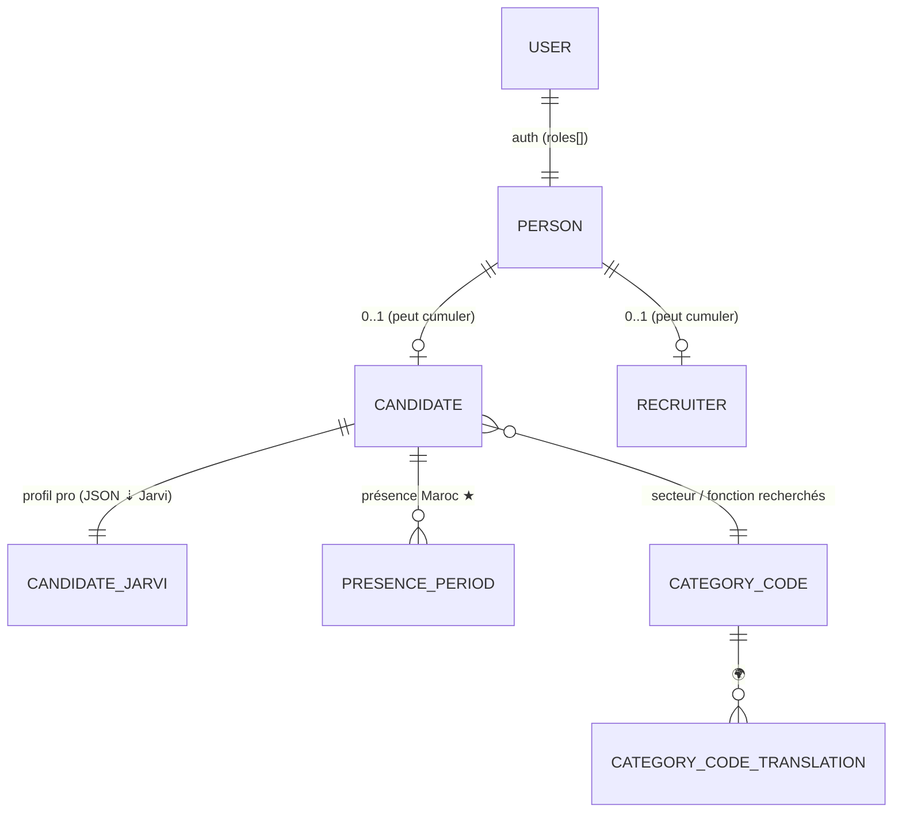
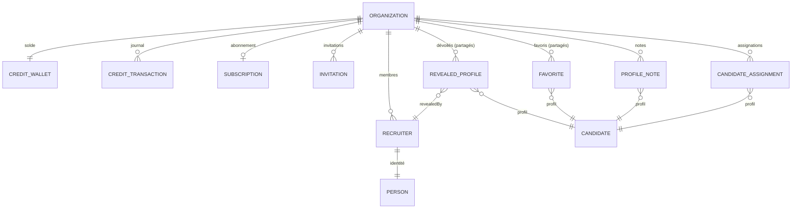

# showcase-recruiter-webapp-saas — Modèle de données

> Modèle conceptuel, source de vérité pour le schéma PostgreSQL (Doctrine) et les ressources
> API Platform. Aligné **schema.org** pour les entités de domaine (SEO/JSON-LD + interop Jarvi).
> Complète [architecture.md](./architecture.md) §4, [jarvi-integration.md](./jarvi-integration.md),
> [i18n.md](./i18n.md).

## Principe d'alignement schema.org

- Les entités **de domaine public** suivent schema.org (`Person`, `Organization`, `JobPosting`,
  `Role`, `MonetaryAmount`, `DefinedTerm`…) → SEO by design + langage commun avec Jarvi.
- Les entités **internes** (auth, crédits, transactions, dévoilés, favoris, sync) sont
  **showcase-recruiter-webapp-saas-spécifiques** : pas de forçage schema.org (anti-KISS).

## Légende

| Symbole | Signification |
| --- | --- |
| 🌐 | type / propriété **schema.org** |
| ★ | donnée **différenciante** showcase-recruiter-webapp-saas |
| ↗ | création initiale possible vers Jarvi si le profil n'existe pas encore |
| 🔑 | donnée différenciante showcase-recruiter-webapp-saas, indexable localement |
| 🌍 | **traduisible** (référentiel / éditorial — pattern racine + `*Translation`) |
| 🔒 | **source de vérité = showcase-recruiter-webapp-saas** |

## Conventions communes

**Identifiants (stratégie hybride)** : toute entité porte une **PK `id` `bigint` auto-incrément**
(usage **interne** : jointures, index, ordre chronologique — jamais exposée) **et** un **`uuid`**
(UUIDv7, unique, indexé, **public** : exposé en API comme IRI, anti-énumération, anti-fuite de
volumétrie). Le `uuid` sert d'`externalId` côté Jarvi seulement pour les ressources qui l'exigent
explicitement (ex. candidats). Les FK référencent l'`id` interne.

Champs communs (`AbstractEntity`) : `uuid`, `createdAt`, `updatedAt`, `deletedAt` (soft delete par
défaut).

### Soft delete — un filtre Doctrine global, pas une colonne décorative

`AbstractEntity::softDelete()` horodate `deletedAt` ; le **filtre Doctrine `soft_delete`**
(`App\Doctrine\Filter\SoftDeleteFilter`, activé par défaut) exclut ces enregistrements de **toutes**
les lectures ORM — listes, référentiels, relations chargées, `find()`. Un repository n'écrit donc
plus `deletedAt IS NULL` : il y aurait deux vérités, et l'oubli d'une seule rouvrirait la fuite.

Deux conséquences à connaître :

- **Le SQL natif n'est pas filtré.** Une requête écrite à la main (ex. recherche JSON dans la réplica
  Jarvi) doit porter sa propre clause `deleted_at IS NULL`.
- **Voir le supprimé est explicite** : un écran d'administration ou une purge RGPD désactive le
  filtre (`$em->getFilters()->disable(SoftDeleteFilter::NAME)`), jamais l'inverse.

Le soft delete est le **seul** mécanisme de retrait : il n'existe pas d'état « déprécié » concurrent.

**Valeurs de référence** : deux familles —
- **vocabulaires ouverts** (secteur, fonction, compétences) → **valeurs libres**, portées par la donnée
  elle-même. Jarvi est maître du profil professionnel ; les listes du cockpit se **déduisent des
  valeurs présentes dans le vivier** (facettes), pas d'un référentiel curé en parallèle
  (`CategoryCode` **abandonné le 2026-07-13** : une table, deux entités et un mécanisme de traduction
  pour quatre termes que l'ingestion ne remplissait jamais) ;
- **états techniques ou petits ensembles fixes** sur lesquels le code branche (sync, type de
  transaction, rôles, visibilité, horizon, dispo) → **`enum` PHP natifs** (labels traduits via
  l'i18n UI quand visibles).

Montants = `MonetaryAmount` (value object embarqué : `amount` en centimes + `currency` ISO 4217).
Dates de présence = `date` (pas datetime).

> Dans les tables ci-dessous, `id`/`uuid`/timestamps sont **implicites** (cf. ci-dessus). Le
> `uuid` n'est listé explicitement que lorsqu'il porte une sémantique (ex. `externalId` Jarvi).

## Vue d'ensemble — mapping schema.org

| Entité showcase-recruiter-webapp-saas | 🌐 schema.org | Nature |
| --- | --- | --- |
| `User` | — | auth + **rôles** (interne) |
| `MagicLinkToken` / `PasswordSetupToken` / `PasswordResetToken` / `RefreshToken` | — | interne (auth) |
| `Person` | **Person** | identité partagée, domaine, 🔒 |
| `Candidate` | (Person) | domaine candidat — différenciants **maîtres showcase-recruiter-webapp-saas** |
| `CandidateJarvi` ⇣ | — | **réplica JSON opaque** du profil pro Jarvi (expériences, formations, langues, compétences, CV) — lecture/synchro only |
| `Recruiter` | (Person) | domaine recruteur |
| `PresencePeriod` ★ | — | domaine ★, 🔑 |
| `Organization` | **Organization** | domaine entreprise ; nom interne showcase-recruiter-webapp-saas aligné sur schema.org |
| `CreditWallet` / `CreditTransaction` | — | interne (facturation) |
| `RevealedProfile` / `Favorite` | — | interne (ACL/usage) |
| `ProfileNote` / `CandidateAssignment` | — | interne (collaboration entreprise) |
| `Subscription` | — | interne (facturation) |
| `Invitation` | — | interne (onboarding) |
| `Notification` | — | interne |
| `ProfileView` | — | interne (activité/analytics) |
| `SavedSearch` | — | interne (recherches enregistrées) |
| `CandidateOption` | — | interne (options payantes candidat) |
| `JarviSyncState` | — | interne (curseur d'ingestion) |

---

# Socle identité & comptes

## `User` (auth + rôles)

Compte d'authentification, relié 1-1 à un `Person`. **Un `Person` peut exister sans `User`**
(candidat invité / importé dont le compte est créé à l'inscription).

**Un même `Person` peut être candidat ET recruteur** (ex. un professionnel de la diaspora qui
cherche un emploi au Maroc *et* recrute dans sa société actuelle). La « casquette » est donc
**multi-valuée** : portée par `roles[]` (natif Symfony Security) + l'existence des lignes
`Candidate` / `Recruiter`. **Pas de champ `type` unique.**

| Champ | Type | Notes |
| --- | --- | --- |
| `email` | string | **login** (unique) |
| `password` | string | hash |
| `roles` | json | combinables : `ROLE_CANDIDATE`, `ROLE_COMPANY_OWNER`, `ROLE_COMPANY_MEMBER`, `ROLE_ADMIN_OWNER`, `ROLE_ADMIN_MEMBER` |
| `status` | enum(`INVITED`,`ACTIVE`,`DISABLED`) | cycle de vie du compte |
| `person` | 1-1 → `Person` | l'identité rattachée |

Hiérarchie de rôles (`security.yaml`) : `ROLE_COMPANY_OWNER` ⊇ `ROLE_COMPANY_MEMBER`,
`ROLE_ADMIN_OWNER` ⊇ `ROLE_ADMIN_MEMBER` ⊇ `ROLE_ADMIN` (parapluie admin).

Dans le parcours entreprise, le `User` déclarant peut être créé par Magic Link avant d'avoir un mot
de passe connu. **Dès la création de l'`Organization`** — donc avant toute décision d'un
administrateur —, showcase-recruiter-webapp-saas émet un token de définition de mot de passe à usage unique ; une fois
consommé, l'utilisateur se connecte par `POST /v1/auth/login`.

## Tokens d'authentification

Quatre entités internes portent les flux d'accès. Aucune ne stocke de secret en clair : les tokens
sont conservés **hachés** (`tokenHash`), à usage unique et expirants.

| Entité | Ancre | Rôle |
| --- | --- | --- |
| `MagicLinkToken` | `email` | connexion sans mot de passe (candidat, déclarant entreprise) |
| `PasswordSetupToken` | `user` | définition du mot de passe après validation métier de l'`Organization` |
| `PasswordResetToken` | `user` | réinitialisation de mot de passe |
| `RefreshToken` | `user` | rafraîchissement du JWT (`POST /v1/auth/refresh`) |

Champs communs à `MagicLinkToken` / `PasswordSetupToken` / `PasswordResetToken` :

| Champ | Type | Notes |
| --- | --- | --- |
| `tokenHash` | string (unique) | hash du token, jamais le token en clair |
| `expiresAt` | datetime | expiration courte |
| `consumedAt` | datetime (null) | usage unique |

Règle : le `PasswordSetupToken` ne valide pas l'entreprise, ne crée pas d'organisation et ne contient
pas de mot de passe temporaire. Il ne sert qu'à définir le hash de mot de passe du `User` ciblé.

## `Person` (🌐 Person) 🔒 ↗

Identité **partagée par tous** (candidats, recruteurs, admins). Mono-langue. Un `Person` porte
**0..1 `Candidate`** et
**0..1 `Recruiter`** — les deux peuvent **coexister**.

| Champ | Type | 🌐 schema.org | ↗ | Notes |
| --- | --- | --- | --- | --- |
| `uuid` | UUID | `identifier` | ↗ (`externalId`) | id **public**, utilisé comme `externalId` uniquement lors d'une création initiale Jarvi |
| `givenName` | string | `givenName` | — | prénom |
| `familyName` | string | `familyName` | — | nom |
| `contactEmail` | string | `email` | — | email de contact (≠ login ; dévoilé par l'accès `EMAIL`) |
| `phone` | string | `telephone` | — | dévoilé par l'accès `PHONE`, qui commande aussi l'identifiant WhatsApp |
| `linkedinUrl` | string | `sameAs` | — | sert au rapprochement/rattachement à l'inscription ; **visible sans crédit** |
| `country` | string (ISO) | `address.addressCountry` | — | pays actuel (Europe) |
| `city` | string | `address.addressLocality` | — | ville actuelle |
| `originLocale` | enum(FR/AR/EN) | `knowsLanguage` (info) | — | langue d'origine du profil |
| `user` | 0..1 → `User` | — | — | compte (absent si invité non inscrit) |

---

# `Candidate` (1-1 `Person`) ↗

`Candidate` = **projection** ancrée sur `jarviProfileId` (unique), portant **uniquement les
différenciants maîtres showcase-recruiter-webapp-saas** + le compte (optionnel) + l'ancre/synchro + le consentement. Le
profil pro vit dans `candidate_jarvi` (⇣ réplica JSONB, **Jarvi maître**, lecture/synchro only) :
CV, expériences, formations, langues, compétences, headline, résumé. showcase-recruiter-webapp-saas **n'édite jamais** un
CV et ne normalise pas champ par champ le profil pro. Profil **mono-langue**. Si un candidat
s'inscrit sans profil Jarvi existant, showcase-recruiter-webapp-saas crée un profil Jarvi minimal pour obtenir l'ancre,
puis la fraîcheur pro redevient descendante.

| Champ | Type | 🌐 schema.org | ↗/🔑 | Notes |
| --- | --- | --- | --- | --- |
| `person` | 1-1 → `Person` | — | — | identité |
| `desiredSector` | string (120) | `occupationalCategory` | 🔑 | secteur **recherché** — valeur libre |
| `desiredFunction` | string (120) | `Occupation` | 🔑 | fonction **recherchée** — valeur libre |
| **★ Projet de retour** | | | | |
| `returnHorizon` | enum(`M3`,`M6`,`Y1`,`THINKING`) | — | 🔑 | horizon de retour au Maroc |
| `returnProject` | text | — | 🔑 | **« Mon projet au Maroc »** |
| **★ Attache au Maroc** | | | | |
| `hasPiedATerre` | bool | — | 🔑 | pied-à-terre au Maroc |
| `piedATerreCity` | string (null) | — | 🔑 | ville du pied-à-terre si `hasPiedATerre` |
| **★ Prétentions** | | | | |
| `salaryExpected` | MonetaryAmount | `estimatedSalary` | 🔑 | salaire souhaité |
| `salaryMin` | MonetaryAmount | — | 🔑 | package minimum |
| `geoMobility` | bool | — | 🔑 | mobilité géographique |
| **★ Disponibilité** | | | | |
| `availability` | enum(`IMMEDIATE`,`NOTICE_1M`,`NOTICE_3M`) | — | 🔑 | disponibilité (préavis) — **distincte de `returnHorizon`** |
| `educationLevel` | enum(`BAC`…`DOCTORAT`, null) | — | 🔑 | niveau d'études le plus élevé, **dérivé** des formations à l'ingestion (task 112) et projeté ici pour être filtrable ; `null` si aucun intitulé reconnaissable |
| **★ Profil Star (maître showcase-recruiter-webapp-saas)** | | | | |
| `starInterviewedAt` | datetime (null) | — | — | profil Star si un entretien showcase-recruiter-webapp-saas a été réalisé |
| `starInterviewReport` | text (null) | — | — | compte rendu d'entretien **showcase-recruiter-webapp-saas** ; exposé aux recruteurs seulement après dévoilement. Distinct du « Récap Entretien » **Jarvi** conservé dans `candidate_jarvi.rawPayload` |
| **Consentement (maître showcase-recruiter-webapp-saas)** | | | | |
| `consentGivenAt` | datetime (null) | — | — | horodatage du consentement à l'exposition dans le vivier |
| `consentSource` | enum(`SELF_SERVICE`,`ONBOARDING`,`MAGIC_LINK`) (null) | — | — | canal par lequel le consentement a été donné |
| **Visibilité / Jarvi** | | | | |
| `visibility` | enum(`VISIBLE`,`HIDDEN`,`RESTRICTED`,`PREMIUM_ONLY`) | — | — | contrôle d'exposition (interne) |
| `visibilityUpdatedAt` | datetime (null) | — | — | dernier changement de visibilité |
| `jarviProfileId` | UUID | `identifier` | — | **ancre de la projection — unique, NOT NULL** |
| `syncStatus` | enum(`PENDING`,`SYNCED`,`FAILED`) | — | — | statut d'ingestion Jarvi / création initiale si absent |
| `syncedAt` | datetime | — | — | dernier passage d'ingestion ou création initiale réussie |
| `active` | bool | — | — | **appartenance au périmètre** ; `false` = sorti du périmètre, conservé en base |

> **⇣** = le profil pro **descend** de Jarvi par ingestion (réplica JSONB `candidate_jarvi`, lecture
> seule). Les différenciants showcase-recruiter-webapp-saas sont indexables localement et restent locaux.

## Exposition d'un candidat aux recruteurs

Un profil est **actionnable par un recruteur** (recherche, dévoilement, favori, note, assignation)
uniquement s'il satisfait les quatre conditions portées par `CandidateExposurePolicy` :

1. `active = true` (dans le périmètre Jarvi showcase-recruiter-webapp-saas) ;
2. `deletedAt IS NULL` ;
3. `visibility = VISIBLE` ;
4. `consentGivenAt IS NOT NULL` (consentement explicite du candidat).

Tant qu'un profil n'est pas dévoilé, l'API **masque** : nom de famille (réduit à l'initiale),
`contactEmail`, `phone`, `linkedinUrl`, métadonnées CV (`resumes`) et `starInterviewReport`.

## Collections & relations

| Relation | Cardinalité | Cible | Maître | 🌐 |
| --- | --- | --- | --- | --- |
| **présence Maroc ★** | 1-N | `PresencePeriod` | **showcase-recruiter-webapp-saas** | — |
| profil pro (CV, exp., formations, langues, compétences) | 1-1 | `CandidateJarvi` ⇣ | **Jarvi** | — |

> Les expériences / formations / langues / compétences vivent comme **objets JSON** dans
> `candidate_jarvi`. Le **secteur/fonction recherchés** sont des **chaînes libres** sur `Candidate`.

## Sous-entités liées

- **`PresencePeriod` ★** (maître showcase-recruiter-webapp-saas, table normalisée) : `startDate`, `endDate` (`date`),
  `city`. **Données différenciantes** — *à quelles dates le candidat sera physiquement au Maroc, donc
  disponible pour des entretiens*. Pas un « voyage » : pure dispo entretien. Indexé localement pour
  la recherche showcase-recruiter-webapp-saas (« présent à Casa en septembre »).
- **Le parcours, projeté en DEUX tables cherchables** — toutes deux DÉRIVÉES des `positions` Jarvi,
  recalculées à chaque ingestion et à chaque `app:vocabulary:reproject`, jamais saisies :
  - **`CandidateJobExperience`** (task `095`) — *le SENS* : une ligne par **métier reconnu** par le
    dictionnaire, avec la durée cumulée. C'est elle qui porte l'élargissement — chercher « software
    engineer » retrouve « Développeur logiciel ». Le signal fiable est la **présence** de la ligne,
    pas `months` : le rattachement des intitulés est partiel, donc la durée sous-estime.
  - **`CandidateJobTitle`** (task `API-037`) — *la LETTRE* : une ligne par **intitulé écrit**, sous
    sa forme canonique. Aucune expansion, aucune traduction. Elle existe parce que la traîne des
    intitulés est trop longue pour être rangée — 5 439 n'apparaissent qu'une fois —, et qu'un
    intitulé hors dictionnaire n'avait sinon aucune ligne où s'écrire : le profil devenait
    introuvable. La recherche s'y replie **uniquement** quand le dictionnaire ignore le terme.

  Les deux ne se remplacent pas et ne comptent pas la même chose. Mesuré sur le vivier : 2 697
  profils visibles sur 3 052 portent un métier reconnu, 2 957 portent un intitulé écrit.

> Les langues parlées et l'expérience par secteur sont normalisées de la même façon
> (`CandidateLanguage`, `CandidateSectorExperience`) et ne sont pas détaillées ici.

## `CandidateJarvi` (1-1 `Candidate`) ⇣ — réplica JSON opaque, lecture/synchro only

Snapshot du **profil pro** descendu de Jarvi par l'ingestion. **Jarvi maître** : showcase-recruiter-webapp-saas n'édite
**jamais** ces données et ne les normalise pas champ par champ — elles sont stockées en **objets
JSONB** dont la structure interne suit Jarvi (cf.
`dev-book/cadrage/candidat/api/profil-jarvi-reference.md`). L'ingestion applique une **liste blanche
de champs** ; les métadonnées d'interface Jarvi (`searchString`, flags…) restent exclues. Les
**comptes rendus Jarvi** (historique chronologique `historyEntries[]` + champs riches
`fieldsValues[]`) sont stockés uniquement dans `rawPayload` comme données sensibles maîtres Jarvi.

| Champ | Type | Notes |
| --- | --- | --- |
| `candidate` | 1-1 → `Candidate` | ancre |
| `headline` | text | accroche pro extraite |
| `summary` | text | résumé pro |
| `workExperiences` | jsonb | array d'objets (`title`, `companyName`, `startDate`, `endDate`, `source`) |
| `educations` | jsonb | array (`school`, `title`, `startDate`, `endDate`) |
| `languages` | jsonb | array (`language`, `proficiency`) |
| `skills` | jsonb | array (`name`) |
| `resumes` | jsonb | **métadonnées CV uniquement** (`fileId`, `name`, `mimeType`, `parsedAt`) — le nom de fichier vit dans `name` |
| `contacts` | jsonb | emails / téléphones (dévoilés sur crédit) |
| `rawPayload` | jsonb (null) | payload brut filtré (filet de sécurité / debug), incluant `historyEntries[]` et `fieldsValues[]` Jarvi sensibles |
| `syncStatus` | enum(`PENDING`,`SYNCED`,`FAILED`) | état de la dernière synchro |
| `syncedAt` | datetime | dernier pull réussi (`updatedAt` Jarvi = curseur) |

> **CV** : l'extraction est faite **côté Jarvi** ; showcase-recruiter-webapp-saas n'édite jamais un CV. Le **binaire n'est
> pas copié** : il est servi à la demande via l'URL de download du storage Jarvi
> (`…/v1/files/<fileId>`).

---

## Diagramme — cluster identité & candidat



## Règles du cluster

- `User` (auth, `roles[]`) 1-1 `Person` ; un `Person` peut exister **sans** `User` (invité).
- **Un `Person` peut être candidat ET recruteur** (casquettes cumulables) → pas de `type` unique,
  rôles multi-valués + existence des lignes `Candidate`/`Recruiter`. UX : switch de contexte.
- `Person` = identité partagée (schema.org Person), utilisée comme ancre locale et `externalId`
  seulement lors d'une création initiale de profil Jarvi si absent.
- `Candidate` / `Recruiter` = tables 1-1 `Person` (0..1 chacune) pour les champs spécifiques.
- **`Candidate` ne porte que les différenciants maîtres showcase-recruiter-webapp-saas** (saisis au formulaire) ; le profil
  pro (CV, expériences, formations, langues, compétences) vit dans **`candidate_jarvi`** (JSON
  opaque, ⇣ Jarvi, lecture/synchro only).
- **CV** : extraction **côté Jarvi**, jamais édité par showcase-recruiter-webapp-saas ; nom de fichier conservé dans
  `candidate_jarvi.resumes[].name` ; binaire **non copié**. **Compte rendu d'entretien Jarvi : ingéré
  comme payload sensible Jarvi, jamais exposé automatiquement.**
- **Profil Star** = **entretien showcase-recruiter-webapp-saas réalisé** (`starInterviewedAt`) + **compte rendu**
  (`starInterviewReport`), maître showcase-recruiter-webapp-saas, distinct du « Récap Entretien » Jarvi. Ni option payante,
  ni simple carte landing.
- Présence Maroc = `PresencePeriod` (dispo entretien, maître showcase-recruiter-webapp-saas), **pas** un voyage.
- Différenciants formulaire **maîtres showcase-recruiter-webapp-saas** (locaux) : `returnHorizon`, `returnProject`,
  pied-à-terre (`hasPiedATerre`/`piedATerreCity`), `availability`, `geoMobility`, prétentions.
- Salaire = `salaryExpected` + `salaryMin`. `availability` (préavis) ≠ `returnHorizon` (horizon retour).
- **Le consentement est maître showcase-recruiter-webapp-saas** : sans `consentGivenAt`, le profil n'est ni cherchable ni
  actionnable, quel que soit son état côté Jarvi.

---

# Entreprise & recrutement (multi-comptes)

Modèle **centré entreprise** : crédits, profils dévoilés, favoris, notes et assignations sont
**partagés au niveau de l'`Organization`** (« espaces communs »). Les recruteurs sont des membres de
l'entreprise ; on trace toujours **quel recruteur** a fait l'action.

## `Organization` (🌐 `Organization`)

L'entreprise marocaine — **entité de facturation** (Stripe customer). `Organization` est le nom
métier interne showcase-recruiter-webapp-saas, aligné sur le type schema.org **`Organization`**.

| Champ | Type | 🌐 schema.org | Notes |
| --- | --- | --- | --- |
| `name` | string | `name` | nom commercial / marque |
| `legalName` | string | `legalName` | raison sociale (facturation) |
| `taxId` | string | `taxID` | ICE / RC (Maroc), pour facturation |
| `country` | string (ISO) | `address.addressCountry` | Maroc par défaut |
| `city` | string | `address.addressLocality` | |
| `billingAddress` | string | `address` | adresse de facturation |
| `logo` | path | `logo` | disque VPS |
| `website` | string | `url` | |
| `stripeCustomerId` | string | — | client Stripe |
| `validationStatus` | enum(`NOUVEAU`,`EMAIL_VERIFIE`,`INCOMPLET`,`EN_REVUE`,`REFUSE`,`VALIDEE`) | — | cycle de revue admin ; création API = `EN_REVUE`. Seul `REFUSE` ferme l'accès ; `NOUVEAU`, `EMAIL_VERIFIE` et `INCOMPLET` ne sont écrits par aucun code |
| `jarviCompanyId` | UUID/string | `identifier` | identifiant de la company Jarvi, renseigné après validation |
| `jarviCompanySyncStatus` | enum(`PENDING`,`SYNCED`,`FAILED`) | — | état de synchro montante vers Jarvi |
| `jarviCompanySyncedAt` | datetime | — | dernier push company Jarvi réussi |
| `jarviCompanySyncError` | text | — | dernier message d'erreur technique, non exposé au front public |

Relations : `recruiters` (1-N), `creditWallet` (1-1), `subscription` (0..1), `revealedProfiles`
(1-N), `favorites` (1-N), `notes` (1-N), `assignments` (1-N), `invitations` (1-N).

Une `Organization` créée par le formulaire entreprise est **immédiatement utilisable**, y compris
ses fonctions sensibles recruteur (crédits, dévoilements, favoris) : la vérification humaine est un
contrôle a posteriori, pas une porte à franchir. Seul `validationStatus === REFUSE` ferme l'accès,
et il le ferme pour **tous** les recruteurs de l'entreprise — la suspension porte sur l'entreprise,
jamais sur la personne, si bien qu'une re-validation rétablit l'accès sans rien avoir à défaire.

⚠️ **Conséquence assumée** : les crédits offerts sont dépensables avant le premier regard humain. Un
refus suspend le compte, il ne reprend pas les coordonnées déjà dévoilées.

La validation admin déclenche l'upsert de la company Jarvi
avec la raison sociale (`legalName`) si disponible, sinon le nom commercial (`name`), puis rattache
le `companyId` retourné au projet recruteur Jarvi configuré (`JARVI_RECRUITER_PROJECT_ID`). **La clé
Jarvi reste côté `api/`** et la synchro est protégée par feature flag en environnement local.

La validation admin envoie également au déclarant `ROLE_COMPANY_OWNER` un e-mail annonçant que son
entreprise est vérifiée. Il ne porte **aucun lien** : l'accès étant déjà ouvert, il n'y a rien à
faire en le lisant. Cet envoi reste local showcase-recruiter-webapp-saas, n'est pas transmis à Jarvi, et ne dépend pas de
la réussite de la synchro.

Après validation, `name` et `legalName` ne sont plus modifiables via le `PUT` standard : toute
modification de l'identité entreprise repasse par un workflow de revue/validation dédié. Les autres
champs administratifs restent éditables selon les droits.

## `Recruiter` (1-1 `Person`)

Membre recruteur d'une entreprise. Un `Recruiter` appartient à **une** `Organization`.

| Champ | Type | Notes |
| --- | --- | --- |
| `person` | 1-1 → `Person` | identité |
| `organization` | FK → `Organization` | `worksFor` (🌐) |
| `organizationRole` | enum(`ROLE_COMPANY_OWNER`,`ROLE_COMPANY_MEMBER`) | **OWNER** : crée l'`Organization`, achète les crédits, invite/gère les droits |
| `jobTitle` | string | 🌐 `Person.jobTitle` |
| `status` | enum(`INVITED`,`ACTIVE`,`DISABLED`) | un recruteur `DISABLED` perd l'accès aux ressources de l'entreprise |

> **OWNER vs MEMBER** : l'owner entreprise gère facturation, invitations et droits ; il inclut par
> hiérarchie les droits du member. Les members consultent, dévoilent (sur le pool partagé) et
> collaborent.

## Crédits (pool partagé entreprise)

### `CreditWallet` (1-1 `Organization`)

Solde courant, **dérivé du journal** mais mis en cache pour lecture rapide.

| Champ | Type | Notes |
| --- | --- | --- |
| `organization` | 1-1 → `Organization` | |
| `balance` | int | solde courant (cache) |

### `CreditTransaction` (journal — source de vérité du solde)

| Champ | Type | Notes |
| --- | --- | --- |
| `organization` | FK → `Organization` | |
| `type` | enum(`GRANT_FREE`,`PURCHASE`,`CONSUMPTION`,`REFUND`,`ADJUSTMENT`) | |
| `amount` | int (signé) | + crédit / − consommation |
| `balanceAfter` | int | solde après opération (audit) |
| `recruiter` | FK → `Recruiter` (null) | qui a déclenché (null = système) |
| `revealedProfile` | FK → `RevealedProfile` (null) | déblocage lié, le cas échéant |
| `reason` | string | libellé |
| `stripePaymentId` | string (null) | pour `PURCHASE` |

> Règle : la **consommation est idempotente** et ne peut pas rendre le solde négatif. Le solde du
> wallet est toujours égal à la somme des transactions.

## Profils dévoilés, favoris & collaboration (partagés entreprise)

Le `Candidate` cible étant une **projection** ancrée sur `jarviProfileId`, `RevealedProfile`,
`Favorite`, `ProfileNote` et `CandidateAssignment` référencent cette projection.

### `RevealedProfile` (Organization × Candidate) — unique

Un déblocage profite à **toute l'entreprise** (espace « déjà dévoilés » commun). Le débit associé est
tracé par la `CreditTransaction` de type `CONSUMPTION` qui pointe vers ce `RevealedProfile`.

| Champ | Type | Notes |
| --- | --- | --- |
| `organization` | FK → `Organization` | |
| `candidate` | FK → `Candidate` | unique avec `organization` |
| `revealedBy` | FK → `Recruiter` | qui a dévoilé (audit) |

### `Favorite` (Organization × Candidate) — unique

Liste de favoris **partagée** de l'entreprise.

| Champ | Type | Notes |
| --- | --- | --- |
| `organization` | FK → `Organization` | |
| `candidate` | FK → `Candidate` | unique avec `organization` |
| `addedBy` | FK → `Recruiter` | |

### `ProfileNote` (Organization × Candidate)

Note partagée sur un candidat, au sein d'une entreprise. Plusieurs notes possibles par candidat.

| Champ | Type | Notes |
| --- | --- | --- |
| `organization` | FK → `Organization` | |
| `candidate` | FK → `Candidate` | |
| `author` | FK → `Recruiter` | |
| `body` | text | |

### `CandidateAssignment` (Organization × Candidate) — unique

Attribution d'un candidat **dévoilé** à un recruteur de l'entreprise (suivi interne). L'assignataire
doit appartenir à l'`Organization` et le candidat doit être dévoilé par cette entreprise.

| Champ | Type | Notes |
| --- | --- | --- |
| `organization` | FK → `Organization` | |
| `candidate` | FK → `Candidate` | unique avec `organization` |
| `assignee` | FK → `Recruiter` | recruteur en charge |
| `assignedBy` | FK → `Recruiter` | qui a assigné (audit) |
| `assignedAt` | datetime | |

## Onboarding & facturation

- **`Invitation`** : l'owner entreprise invite des collègues. `organization`, `email`, `role`
  (`ROLE_COMPANY_MEMBER` par défaut), `token`, `status` (`PENDING`/`ACCEPTED`/`EXPIRED`),
  `invitedBy`, `expiresAt`. (L'invitation **candidat** — lien d'inscription du brief — est un
  mécanisme distinct, plus simple.)
- **`Subscription`** (0..1 `Organization`) : `plan`, `status` (`ACTIVE`/`PAST_DUE`/`CANCELED`),
  `currentPeriodEnd`, `stripeSubscriptionId`.

## Diagramme — cluster entreprise



## Règles du cluster

- **Crédits = pool partagé `Organization`** (journal `CreditTransaction` + cache `CreditWallet`).
- **Dévoilés, favoris, notes et assignations partagés** au niveau entreprise (unicité
  `(organization, candidate)` pour les dévoilés, favoris et assignations), on trace le recruteur.
- **Rôles entreprise** : `ROLE_COMPANY_OWNER` (facturation, invitations, droits) +
  `ROLE_COMPANY_MEMBER`.
- **Achat et diffusion/allocation de crédits réservés à `ROLE_COMPANY_OWNER`** (pour sa team). Un
  `ROLE_COMPANY_MEMBER` consomme les crédits alloués mais n'achète pas et ne les redistribue pas.
- **1 `Recruiter` = 1 `Organization`**.
- **Coût d'un dévoilé = 1 crédit fixe** (`CreditPolicy::REVEAL_COST`).
- **2 crédits offerts à la création** de l'`Organization` (`CreditTransaction` `GRANT_FREE` +2).
- **Une assignation exige un profil dévoilé** par l'entreprise et un assignataire membre de
  l'`Organization`.
- Facturation = `Organization` (Stripe).

---

# Référentiels

**Il n'y a plus de référentiel en base.** `CategoryCode` et sa table de traduction ont été supprimés
le 2026-07-13 : ils portaient un vocabulaire curé (secteurs, fonctions) que **l'ingestion Jarvi ne
remplissait jamais** — seules les fixtures l'alimentaient, avec quatre termes.

Secteur et fonction sont désormais des **valeurs libres** (`Candidate.desiredSector`,
`Candidate.desiredFunction`, `Organization.sector`), telles que le profil professionnel les porte.
Les listes du cockpit se **déduisent des valeurs réellement présentes** dans le vivier (agrégats /
facettes), ce qui reflète la donnée au lieu de la contredire.

Les libellés d'interface, eux, restent dans le catalogue i18n du front — la base ne stocke plus
aucune traduction.


---

# Notifications, activité & recherches enregistrées

## `Notification`

Notification adressée à un `Person`. Canaux **in-app + email** (SMTP).

| Champ | Type | Notes |
| --- | --- | --- |
| `recipient` | FK → `Person` | destinataire (in-app si compte, email via `contactEmail`) |
| `type` | enum PHP | `PROFILE_REVEALED`, `PROFILE_IN_SEARCHES`, `PROFILE_RECOMMENDED`, `PROFILE_VIEWED_OFTEN`, `NEW_QUALIFIED_PROFILE`, `CREDITS_LOW` |
| `channels` | set(`IN_APP`,`EMAIL`) | |
| `relatedOrganization` | FK → `Organization` (null) | entité liée (**FK**, pas dans `data`) |
| `relatedCandidate` | FK → `Candidate` (null) | entité liée (**FK**, pas dans `data`) |
| `data` | json | contexte **non-relationnel** : compteurs, libellés (ex. `{ "count": 12 }`). **Aucun id / relation** |
| `readAt` | datetime (null) | lu / non lu |
| `emailSentAt` | datetime (null) | trace d'envoi |

## `ProfileView` (activité / analytics)

Trace une **consultation** de profil (≠ déblocage). Alimente les stats candidat (« X recherches /
consultations ») et l'**historique des profils visités** du dashboard admin. Append-only ;
agrégations calculées à la lecture.

| Champ | Type | Notes |
| --- | --- | --- |
| `candidate` | FK → `Candidate` | profil consulté |
| `organization` | FK → `Organization` | entreprise consultante |
| `recruiter` | FK → `Recruiter` | qui a consulté |

> **Écriture (task API-072)** : la trace est posée **par le serveur** quand un recruteur obtient
> `GET /v1/candidates/{uuid}` — l'interface n'a rien à envoyer, et aucun écran ne peut l'oublier.
> **Une seule visite par recruteur, par candidat et par jour civil** : trois retours sur la même
> fiche dans l'après-midi ne disent pas trois intérêts, et le compteur montré au candidat
> sur-compterait une seule personne. Un appelant sans recruteur rattaché (admin, candidat) n'écrit
> rien, et un échec d'écriture **ne fait jamais échouer la lecture** — la fiche prime sur la trace.
>
> ⚠️ **Conservation non tranchée** : une visite dit qu'un recruteur nommé a regardé une personne
> nommée, à une date. Aucune purge n'existe ; la durée de rétention relève du volet RGPD encore
> ouvert (`dev-book/todo.md`).

> **Lecture candidat** : `GET /v1/candidates/{uuid}/activity` (self-only) renvoie des compteurs
> agrégés — `profileViews` (`ProfileView`), `reveals` (`RevealedProfile`), `interestedCompanies`
> (`Favorite`). **L'identité des entreprises n'est jamais exposée** (compteurs seuls).

## `SavedSearch`

Recherche enregistrée d'un recruteur.

| Champ | Type | Notes |
| --- | --- | --- |
| `owner` | FK → `Recruiter` | |
| `organization` | FK → `Organization` | |
| `name` | string | |
| `criteria` | json | **valeurs métier** : mots-clés, `codeValue` (slugs) de secteurs/fonctions, codes langue, dispo, dates. **Pas d'ids/FK** (config de recherche) |
| `alertEnabled` | bool | active les alertes sur cette recherche |
| `channels` | set(`IN_APP`,`EMAIL`) | canaux de l'alerte |
| `closedAt` | datetime? | quand le travail a été déclaré terminé — nul tant que la recherche est active |
| `lastActivityAt` | datetime | **dernier contact humain**, cf. ci-dessous |

### `lastActivityAt` n'est pas `updatedAt`, et c'est tout l'enjeu

Les deux dates répondent à deux questions différentes : « quand la ligne a-t-elle changé » et
**« quand quelqu'un s'est-il occupé de cette recherche »**.

Seuls les gestes humains poussent `lastActivityAt` — ouvrir le jeu, marquer vu, écarter, remettre,
retenir, libérer, ajuster les critères, renommer, partager, exporter, rouvrir. Ils passent tous par
`SearchActivityRecorder`, point d'entrée unique.

**Le recalcul du jeu n'en est pas un.** Chaque ingestion Jarvi rejoue toutes les recherches de la
base : si elle touchait cette date, la clôture automatique (`app:searches:close-inactive`) ne
fermerait plus jamais rien — et le défaut serait invisible, tout paraissant fonctionner.

La date est portée par la **recherche**, pas par son lecteur : sur une recherche partagée, le geste
d'un collègue la garde ouverte pour tout le monde, comme `closedAt` vaut pour tout le monde.

> **Ajout en base existante.** Le dépôt n'a pas encore de migrations (`dev-schema` recrée le schéma
> depuis le mapping, cf. `docker-and-make.md`). La colonne est **non nulle** : sur une base qui porte
> déjà des lignes, elle se pose en trois temps, et la première migration de production devra les
> reprendre.
>
> ```sql
> ALTER TABLE saved_search ADD COLUMN last_activity_at TIMESTAMP(0) WITHOUT TIME ZONE;
> UPDATE saved_search SET last_activity_at = updated_at;
> ALTER TABLE saved_search ALTER COLUMN last_activity_at SET NOT NULL;
> ```

## `UnresolvedJobTerm` (ce que le dictionnaire ignore)

Intitulé de poste sur lequel une recherche a été **lancée** et que le vocabulaire ne connaît pas. Le
filtre par métier exige une correspondance exacte : un terme hors dictionnaire ramène zéro profil,
quoi qu'il y ait dans le vivier. Cette table est la seule façon de savoir lesquels manquent — sans
elle le vocabulaire s'enrichit à l'intuition. Lecture : `app:vocabulary:missing`.

**Aucune donnée personnelle** : ni recruteur, ni organisation. Le nombre d'occurrences suffit à
prioriser, et l'alternative constituerait un historique nominatif de ce que chaque client cherche.

| Champ | Type | Notes |
| --- | --- | --- |
| `term` | string (unique) | clé de regroupement : minuscules, espaces de bord retirés |
| `label` | string | le terme **tel qu'il a été tapé**, pour la lecture humaine |
| `occurrences` | int | incrémenté en base (`ON CONFLICT`), jamais lu-puis-écrit |
| `lastSearchedAt` | datetime | dernier lancement |

Un métier **connu mais que personne n'exerce** n'entre pas ici : il ramène zéro lui aussi, mais il
dit autre chose, et les mélanger rendrait la liste inexploitable.

## `JarviSyncState` (curseur d'ingestion)

État d'avancement des synchros descendantes Jarvi, une ligne par pipeline (`name` unique).

| Champ | Type | Notes |
| --- | --- | --- |
| `name` | string (unique) | identifiant du pipeline |
| `cursor` | datetime (null) | curseur `updatedAt` du dernier profil ingéré sain |
| `lastRunAt` | datetime (null) | dernier passage |

---

# Options payantes candidat

## `CandidateOption`

Option payante souscrite par un **candidat** (monétisation espace candidat).

| Champ | Type | Notes |
| --- | --- | --- |
| `candidate` | FK → `Candidate` | |
| `type` | enum(`BADGE_PREMIUM`,`HOMEPAGE_FEATURE`,`SEARCH_BOOST`,`RECRUITER_SELECTION`) | |
| `startsAt` / `endsAt` | datetime | période d'activation |
| `status` | enum(`ACTIVE`,`EXPIRED`,`CANCELED`) | |
| `stripePaymentId` | string (null) | paiement candidat (Stripe) |

---

# Mise en avant « profils stars » (landing)

**Pas d'entité éditoriale dédiée.** Le statut star est porté par le **profil candidat**
(`Candidate.starInterviewedAt` + `starInterviewReport`, compte rendu exposé **après dévoilement**) ;
la **mise en avant sur la landing** est dérivée de ce statut **côté front**, sans table ni gestion
admin.

---

## Règles de ces blocs

- **`Notification`** générique : `recipient` = `Person` (et non `User`) → permet de notifier par email
  un invité sans compte. Canaux in-app + email.
- **`ProfileView`** trace les consultations (stats candidat + historique admin), append-only.
- **`SavedSearch`** porte les critères en **valeurs métier**, jamais d'ids : une recherche est
  rejouable indépendamment des clés internes.
- **`JarviSyncState`** garde le curseur d'ingestion : la synchro descendante reprend là où elle s'est
  arrêtée.
- **Profils stars (landing)** : pas d'entité dédiée ; statut porté par `Candidate.starInterviewedAt`,
  mise en avant **côté front**.
